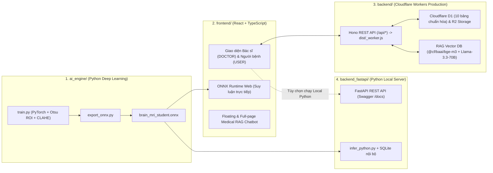

# NeuroScan AI — Hệ thống Phân loại U não từ Ảnh MRI & Trợ lý AI Y tế (Vector RAG)

Nền tảng hỗ trợ đọc hiểu hình ảnh học Cộng hưởng từ (MRI) sọ não 4 phân lớp theo tiêu chuẩn **WHO CNS5 (2021)** (`Glioma`, `Meningioma`, `Pituitary`, `No Tumor`), kết nối luồng hội chẩn chuyên môn giữa **Bác sĩ Chuyên khoa (`DOCTOR`)** và **Người bệnh (`USER`)**, tích hợp **Trợ lý AI Y tế Vector RAG** vận hành trên hạ tầng **Cloudflare Edge & ONNX Runtime**.

---

## 1. Kiến trúc Tổng thể & Mối liên hệ giữa 4 Thư mục trong Dự án

```text
d:\MRI\
├── frontend/          # Giao diện Web (React 18 + TypeScript + Vite + Tailwind CSS + ONNX Runtime Web)
├── backend/           # Backend Production chính thức (Cloudflare Workers + Hono + D1 + R2 + Vectorize + Workers AI)
├── ai_engine/         # Pipeline huấn luyện Deep Learning (PyTorch + OpenCV Otsu/CLAHE) & xuất model .onnx
├── backend_fastapi/   # Máy chủ Python FastAPI nội bộ tùy chọn (tích hợp trực tiếp với ai_engine & ONNX Runtime Python)
└── wrangler.jsonc     # Cấu hình triển khai Cloudflare Pages, D1 Database, R2 Bucket, Vectorize & Workers AI
```



### Chi tiết vai trò từng module:
1. **`frontend/` (Giao diện & Suy luận Edge Client):**
   - Chứa toàn bộ giao diện phân quyền RBAC (`DOCTOR` / `USER`), Trạm đọc ảnh MRI đa chế độ, Computer Vision Lab, Quản lý hồ sơ bệnh nhân và Trợ lý AI Y tế.
   - Chứa mô hình [`frontend/public/models/brain_mri_student.onnx`](file:///d:/MRI/frontend/public/models/brain_mri_student.onnx) và 4 ảnh chụp MRI sọ não lâm sàng chuẩn tại [`frontend/public/sample_scans/`](file:///d:/MRI/frontend/public/sample_scans/).
   - Khi chạy `npm run build`, script [`frontend/scripts/build-worker.mjs`](file:///d:/MRI/frontend/scripts/build-worker.mjs) tự động đóng gói **`backend/src/index.ts`** thành `frontend/dist/_worker.js` để triển khai đồng nhất cả Frontend + Backend API lên Cloudflare Pages (`https://neuroscan.pages.dev`).
2. **`backend/` (Backend Production trên Cloudflare Workers):**
   - **Được sử dụng trực tiếp trên Production (`https://neuroscan.pages.dev`)**.
   - Xây dựng bằng **Hono + TypeScript**, kết nối trực tiếp với **Cloudflare D1** (10 bảng quan hệ: `users`, `patients`, `doctors`, `mri_scans`, `predictions`, `doctor_reviews`, `chat_sessions`, `chat_messages`, `faq_documents`, `rag_chunks`), **Cloudflare R2**, **Cloudflare Vectorize** và **Workers AI** (`@cf/baai/bge-m3` 1024-dim embeddings + `@cf/meta/llama-3.3-70b-instruct-fp8-fast`).
3. **`ai_engine/` (Huấn luyện Mô hình & Xuất ONNX):**
   - Chứa mã nguồn huấn luyện mạng nơ-ron (`model.py`, `train.py`) với thuật toán cắt vùng sọ não tự động **Otsu Contour ROI** và cân bằng tương phản cục bộ **CLAHE**, sau đó xuất trọng số sang chuẩn ONNX qua `export_onnx.py` để cung cấp cho `frontend/public/models/brain_mri_student.onnx`.
4. **`backend_fastapi/` (Máy chủ Python FastAPI Local tùy chọn):**
   - Cung cấp máy chủ REST API bằng Python FastAPI (`http://127.0.0.1:8000/docs`), liên kết trực tiếp với hàm tiền xử lý `ai_engine/infer_python.py` và mô hình `brain_mri_student.onnx` để phục vụ kiểm thử hoặc chạy độc lập trên môi trường Python nội bộ.

---

## 2. Tài khoản Kiểm thử Mặc định (RBAC)

| Vai trò | Họ và tên | Email | Mật khẩu | Đường dẫn chính |
| :--- | :--- | :--- | :--- | :--- |
| **Bác sĩ (`DOCTOR`)** | BS.CKII Trần Quốc Bảo | `demo.doctor@neuroscan.vn` | `Doctor@123` | `/doctor/dashboard` |
| **Người bệnh (`USER`)** | Nguyễn Minh An | `demo.user@neuroscan.vn` | `User@123` | `/dashboard` |
| **Quản trị (`ADMIN`)** | Quản trị viên Hệ thống | `admin@neuroscan.vn` | `Admin@123` | `/doctor/dashboard` |

---

## 3. Hướng dẫn Khởi chạy & Xây dựng Dự án

### Chạy môi trường phát triển Frontend:
```bash
cd frontend
npm install
npm run dev
```

### Build bản Production (Frontend + Cloudflare Worker `_worker.js`):
```bash
cd frontend
npm run build
```

### Chạy thử Backend FastAPI Python (Tùy chọn):
```bash
cd backend_fastapi
pip install -r requirements.txt
python run.py
```
