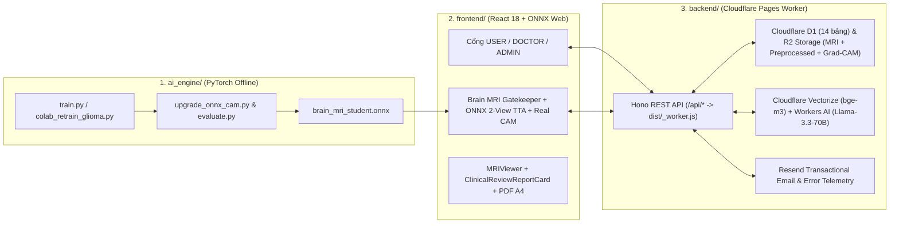

# NeuroScan AI — Nền tảng Hỗ trợ Phân loại U não MRI & Trợ lý AI Y tế (Vector RAG)

[](https://neuroscan.pages.dev)
[](./frontend)
[](./backend)
[](./ai_engine)

Nền tảng hỗ trợ phân tích hình ảnh Cộng hưởng từ (MRI) sọ não 4 phân lớp theo tiêu chuẩn **WHO CNS5 (2021)** (`Glioma`, `Meningioma`, `Pituitary`, `No Tumor`), kết nối luồng hội chẩn chuyên môn theo phân quyền **3 vai trò RBAC** (**Người bệnh `USER`**, **Bác sĩ Chuyên khoa `DOCTOR`**, **Quản trị viên Bệnh viện `ADMIN`**), tích hợp **Trợ lý AI Y tế Vector RAG** và **Giám sát lỗi 24/7**, vận hành trọn gói trên hạ tầng **Cloudflare Edge & ONNX Runtime Web**.

> **Khuyến cáo An toàn Y tế:** Hệ thống và Trợ lý AI chỉ cung cấp thông tin tham khảo phục vụ học tập, nghiên cứu và hỗ trợ tra cứu; hoàn toàn không thay thế tư vấn, chẩn đoán lâm sàng hoặc phác đồ điều trị từ bác sĩ chuyên khoa.

---

## 1. Tính năng Nổi bật

### 1.1. Phân tích MRI Sọ não trên Trình duyệt (Client-Side Edge AI)
- **Mô hình ONNX thực thi trực tiếp qua WebAssembly (`onnxruntime-web`):** Suy luận nhanh (~40–250ms) không cần gửi dữ liệu thô ra máy chủ bên thứ ba khi dùng thử.
- **2-View Horizontal-Flip TTA & Real CNN CAM (`brain_mri_student_v2_tta_cam_onnx`):** Kết hợp tăng cường suy luận đối xứng hai bán cầu não (Test-Time Augmentation), xuất trực tiếp bản đồ nhiệt giải thích AI (**Grad-CAM / CNN CAM**) và cảnh báo vùng giao thoa lâm sàng `Glioma ↔ Meningioma`.
- **Bộ lọc tiền kiểm ảnh MRI (`Brain MRI Gatekeeper`):** Kiểm định đa đặc trưng trên pixel gốc (độ bão hòa màu, cấu trúc 4 góc nền tối, kết cấu đồ họa phẳng) để từ chối nhất quán ảnh không phải lát cắt MRI (ảnh màu, logo, meme, tài liệu nền trắng), ngăn hoàn toàn tình trạng trả kết quả giả `No Tumor`.
- **Hỗ trợ định dạng y khoa DICOM (`.dcm`) & ảnh tiêu chuẩn (PNG/JPG):** Giải mã lát cắt DICOM ngay trên trình duyệt, tích hợp Trạm đọc phim `MRIViewer` (phóng to/thu nhỏ, kéo pan, so sánh Ảnh gốc ↔ Tiền xử lý ROI/CLAHE ↔ Grad-CAM Heatmap).
- **Lưu trữ bền vững Cloudflare R2 + D1:** Khi người dùng đã đăng nhập, toàn bộ ảnh gốc, ảnh tiền xử lý và bản đồ nhiệt Grad-CAM được lưu trữ riêng tư trên **Cloudflare R2** và liên kết với **Cloudflare D1** để cả Bệnh nhân lẫn Bác sĩ xem lại bất cứ lúc nào.
- **Xuất báo cáo lâm sàng:** Hỗ trợ xuất phiếu kết quả dạng văn bản và **In / Xuất PDF chuẩn A4**.

### 1.2. Luồng Hội chẩn Bác sĩ (`DOCTOR`) & Phiếu Kết quả Bệnh nhân (`USER`)
- **Trạm Đánh giá Lâm sàng chuẩn RIS/PACS (`/doctor/cases/:id` & `/doctor/vision-analysis`):**
  - Chọn xác nhận/hiệu chỉnh nhãn bệnh học, đánh giá độ phù hợp AI và trạng thái ca bằng **thẻ bấm 1-Click** đồng bộ trên cả trang chi tiết ca bệnh lẫn Computer Vision Lab.
  - **Mẫu câu lâm sàng nhanh (Clinical Macros)** & gợi ý hướng xử trí 1-Click giúp rút ngắn thời gian lập phiếu.
  - **Chế độ Xem trước góc nhìn Bệnh nhân (Live Preview)** trước khi ký duyệt.
  - **Tách biệt Ghi chú kỹ thuật nội bộ** (có khóa bảo vệ, ẩn hoàn toàn với Bệnh nhân).
- **Phiếu Nhận xét Lâm sàng cho Bệnh nhân (`/mri-results/:id`):** Hiển thị thanh ký duyệt Bác sĩ, lưới đối chiếu 2 cột (Kết luận Bác sĩ vs Gợi ý AI), nhận xét chi tiết và khối Khuyến nghị bước tiếp theo rõ ràng.
- **Quản lý Hồ sơ Bệnh nhân (`/doctor/patients`) & Computer Vision Lab (`/doctor/vision-analysis`):** Cho phép bác sĩ tra cứu hồ sơ bệnh nhân, phân tích trực tiếp lát cắt MRI và ký duyệt đồng bộ ngay vào hồ sơ bệnh nhân.
- **Chuẩn giao diện Lâm sàng Tối giản (Clinical Editorial UI):** Bảng màu y khoa `Slate + Teal` chuẩn tương phản WCAG 2.2 AA, hỗ trợ đầy đủ giao diện Sáng / Tối (`Light / Dark Mode`) và tương thích đa thiết bị.

### 1.3. Trợ lý AI Y tế Vector RAG (198 Tài liệu Chuẩn hóa)
- Tìm kiếm ngữ nghĩa kết hợp **Cloudflare Vectorize** (`@cf/baai/bge-m3`, 1024 chiều) + **Cloudflare Workers AI** (`@cf/meta/llama-3.3-70b-instruct-fp8-fast`) trên kho tri thức 198 tài liệu chuẩn hóa từ WHO CNS5, ACR, NCI, NHS.
- Tích hợp **bộ lọc cảnh báo cờ đỏ cấp cứu thần kinh (115)** theo thời gian thực và hỗ trợ gắn ngữ cảnh ca chụp MRI vào phiên hội thoại.

### 1.4. Cổng Quản trị Bệnh viện (`/admin`) & Bảo mật Production
- **Quản lý Bác sĩ & Chứng chỉ Hành nghề (CCHN):** Cấp mới tài khoản bác sĩ, xác minh CCHN, khóa/mở khóa trạng thái hoạt động.
- **Nhật ký Kiểm toán (`audit_logs`):** Ghi nhận mọi thao tác nhạy cảm (đăng nhập, đổi mật khẩu, cập nhật hồ sơ, bác sĩ ký duyệt, quản trị viên thao tác).
- **Quản trị Kho tri thức FAQ/RAG:** Thêm/sửa/xóa tài liệu y khoa và kích hoạt đồng bộ lại chỉ mục Vectorize.
- **Giám sát lỗi 24/7 (`error_logs` Telemetry):** Tự động thu thập lỗi runtime ẩn danh từ trình duyệt (`React ErrorBoundary` / `window.onerror`) và lỗi HTTP 500 từ Cloudflare Worker.
- **Xác thực & Khôi phục mật khẩu:** Mật khẩu băm **PBKDF2 + Salt**, phiên đăng nhập **HttpOnly Cookie** (`user_sessions`), khôi phục mật khẩu qua **Resend API** (mã 6 chữ số băm SHA-256 hiệu lực 15 phút), chống IDOR trên toàn bộ API và tệp R2, kèm các trang pháp lý `/privacy-policy`, `/terms-of-service`.

---

## 2. Kiến trúc Tổng thể Hệ thống

```text
NeuroScanAI/
├── frontend/                  # React 18 + TypeScript + Vite + Tailwind CSS + ONNX Runtime Web
│   ├── public/
│   │   ├── models/            # Mô hình brain_mri_student.onnx (Dual-output: logits + cam_maps)
│   │   ├── ort/               # WebAssembly runtime (ort-wasm-simd-threaded.wasm)
│   │   └── sample_scans/      # 4 bộ lát cắt MRI & Grad-CAM mẫu chuẩn
│   ├── scripts/
│   │   └── build-worker.mjs   # Đóng gói backend/src/index.ts -> frontend/dist/_worker.js
│   └── src/
│       ├── app/               # Router, AuthProvider, ThemeProvider, ToastProvider, ProtectedRoute
│       ├── components/        # MRIViewer, ClinicalReviewReportCard, PredictionCard, ProbabilityChart...
│       ├── features/          # landing, auth, mri, doctor, admin, chatbot, knowledge, settings, legal
│       └── services/          # mriInferenceService.ts (ONNX + Gatekeeper + TTA + CAM), neuroscanAdapter.ts
├── backend/                   # Cloudflare Workers + Hono + TypeScript (Edge API duy nhất)
│   ├── migrations/
│   │   └── 0001_schema.sql    # 14 bảng chuẩn hóa trên Cloudflare D1 (SQLite)
│   └── src/
│       ├── index.ts           # Toàn bộ REST API (/api/*), R2 file serving, Resend email, Telemetry
│       ├── middleware/        # Xác thực HttpOnly Session Cookie & RBAC
│       ├── utils/             # PBKDF2/SHA-256 crypto, RAG Vectorize, Chatbot medical safety
│       └── db/fallback.ts     # In-memory fallback cho môi trường dev nội bộ không có D1
├── ai_engine/                 # Huấn luyện Deep Learning (PyTorch), Grad-CAM & Xuất ONNX Offline
│   ├── model.py               # Kiến trúc mạng CNN phân loại 4 lớp
│   ├── train.py               # Script huấn luyện chính trên tập dữ liệu MRI
│   ├── colab_retrain_glioma.py# Script 1-Click GPU Colab tăng cường Recall cho lớp Glioma
│   ├── gradcam.py             # Engine tính Grad-CAM thực từ tầng tích chập cuối
│   ├── export_onnx.py         # Xuất trọng số PyTorch sang chuẩn ONNX
│   ├── upgrade_onnx_cam.py    # Nâng cấp mô hình ONNX xuất đồng thời logits + cam_maps
│   ├── evaluate.py            # Đánh giá chỉ số Precision/Recall/F1/Confusion Matrix -> eval_report.json
│   └── infer_python.py        # Kiểm thử suy luận độc lập bằng Python CLI
├── .github/workflows/ci.yml   # Pipeline CI kiểm tra Typecheck & Build tự động
├── PRODUCTION_DEPLOY_GUIDE.md # Hướng dẫn cấu hình Cloudflare Production chi tiết
└── wrangler.jsonc             # Cấu hình Cloudflare Pages, D1, R2, Vectorize & Workers AI
```



---

## 3. Kết quả Đánh giá Mô hình AI Thực nghiệm

Đo lường độc lập bằng [`ai_engine/evaluate.py`](./ai_engine/evaluate.py) trên **1.600 ảnh MRI tập Testing** (400 ảnh/lớp, kết quả lưu tại [`ai_engine/eval_report.json`](./ai_engine/eval_report.json)):

| Lớp phân loại (WHO CNS5) | Precision | Recall | F1-Score | Số lượng mẫu (Support) |
| :--- | :---: | :---: | :---: | :---: |
| **Glioma** (U thần kinh đệm) | 96.93% | 86.75% | 91.56% | 400 |
| **Meningioma** (U màng não) | 90.63% | 96.75% | 93.59% | 400 |
| **Pituitary** (U tuyến yên) | 98.03% | 99.75% | 98.88% | 400 |
| **No Tumor** (Không phát hiện u) | 96.81% | 98.75% | 97.77% | 400 |
| **Tổng hợp (Macro / Overall)** | **95.60%** | **95.50%** | **95.45%** | **1.600 (1.528 đúng — Accuracy 95.50%)** |

---

## 4. Cơ sở dữ liệu Cloudflare D1 (14 Bảng Chuẩn hóa)

Định nghĩa đầy đủ trong [`backend/migrations/0001_schema.sql`](./backend/migrations/0001_schema.sql):

| Nhóm nghiệp vụ | Danh sách bảng | Mục đích |
| :--- | :--- | :--- |
| **Tài khoản & RBAC** | `users`, `patients`, `doctors`, `user_sessions`, `password_reset_tokens` | Quản lý 3 vai trò (`patient`, `doctor`, `admin`), hồ sơ, CCHN bác sĩ, phiên cookie và mã đặt lại mật khẩu 15 phút |
| **Phân tích MRI & Hội chẩn** | `mri_scans`, `predictions`, `doctor_reviews` | Lưu khóa R2 ảnh gốc, kết quả Softmax 4 lớp, URL R2 ảnh tiền xử lý & Grad-CAM, và nhận xét lâm sàng của bác sĩ |
| **Trợ lý AI & Vector RAG** | `chat_sessions`, `chat_messages`, `faq_documents`, `rag_chunks` | Lưu lịch sử hội thoại y tế gắn ca MRI và 198 tài liệu tri thức RAG đồng bộ Vectorize |
| **Kiểm toán & Giám sát** | `audit_logs`, `error_logs` | Nhật ký kiểm toán bảo mật và thu thập lỗi Telemetry 24/7 từ Frontend/Worker |

---

## 5. Tổng hợp REST API Chính (`backend/src/index.ts`)

| Nhóm API | Endpoints tiêu biểu |
| :--- | :--- |
| **Xác thực & Hồ sơ** | `POST /api/auth/register`, `POST /api/auth/login`, `GET /api/auth/me`, `POST /api/auth/logout`, `PUT /api/auth/profile`, `POST /api/auth/change-password`, `POST /api/auth/forgot-password`, `POST /api/auth/reset-password` |
| **MRI, R2 & Suy luận** | `POST /api/scans`, `POST /api/predict`, `GET /api/predictions`, `GET /api/predictions/:id`, `DELETE /api/scans/:id`, `POST /api/predictions/:id/request-review`, `GET /api/files/*` |
| **Hội chẩn Bác sĩ & Bệnh nhân** | `POST /api/reviews`, `GET /api/patients`, `GET /api/patients/:id`, `POST /api/patients`, `PUT /api/patients/:id`, `DELETE /api/patients/:id`, `GET /api/stats` |
| **Chatbot & Vector RAG** | `POST /api/chat`, `GET /api/chat/history`, `GET /api/chat/sessions`, `POST /api/chat/sessions`, `DELETE /api/chat/sessions/:id`, `GET /api/rag/status`, `POST /api/rag/index`, `GET/POST/PUT/DELETE /api/faq` |
| **Quản trị & Telemetry** | `GET /api/admin/doctors`, `POST /api/admin/doctors`, `PATCH /api/admin/doctors/:id/status`, `GET /api/audit-logs`, `POST /api/telemetry/error`, `GET /api/admin/telemetry`, `GET /api/health` |

---

## 6. Biến môi trường & Secrets (Cloudflare Pages)

Các biến văn bản được khai báo trong [`wrangler.jsonc`](./wrangler.jsonc) và các khóa bí mật cấu hình trong **Cloudflare Pages → Settings → Variables and secrets**:

| Tên biến | Loại | Mô tả |
| :--- | :---: | :--- |
| `ENVIRONMENT` | Text | `production` hoặc `development` |
| `CF_EMBEDDING_MODEL` | Text | `@cf/baai/bge-m3` |
| `CF_LLM_MODEL` | Text | `@cf/meta/llama-3.3-70b-instruct-fp8-fast` |
| `AI_GATEWAY_ID` | Text | `neuroscan-gateway` |
| `SESSION_SECRET` | **Secret** | Khóa bí mật ký token phiên đăng nhập HMAC-SHA256 |
| `RESEND_API_KEY` | **Secret** | API Key của [Resend](https://resend.com) gửi email đặt lại mật khẩu |
| `RESEND_FROM_EMAIL` | **Secret** | Địa chỉ người gửi (mặc định sandbox: `NeuroScan AI <onboarding@resend.dev>`, hoặc domain đã xác minh) |

---

## 7. Hướng dẫn Cài đặt, Chạy Local & Triển khai Production

### 7.1. Chạy môi trường phát triển (Frontend + Hono Backend API tích hợp)
```bash
cd frontend
npm install
npm run dev
```
*(Khi chạy `npm run dev`, [`frontend/vite.config.ts`](./frontend/vite.config.ts) tự động gắn trực tiếp `backend/src/index.ts` qua Hono dev middleware.)*

### 7.2. Kiểm tra TypeScript, Build Frontend & Đóng gói Cloudflare Worker (`_worker.js`)
```bash
cd frontend
npm run build
```

### 7.3. Khởi tạo CSDL Cloudflare D1 & Triển khai lên Cloudflare Pages
```bash
# 1. Chạy migration 14 bảng lên Cloudflare D1 Remote
npx wrangler d1 execute neuroscan-db --remote --file=./backend/migrations/0001_schema.sql

# 2. Deploy bản build (Frontend + _worker.js) lên Cloudflare Pages
cd frontend
npx wrangler pages deploy dist --project-name neuroscan
```
*(Xem thêm hướng dẫn triển khai chi tiết từng bước tại [`PRODUCTION_DEPLOY_GUIDE.md`](./PRODUCTION_DEPLOY_GUIDE.md).)*

### 7.4. Chạy Pipeline AI Engine Offline (Python / PyTorch)
```bash
cd ai_engine
pip install -r requirements.txt

# Đánh giá mô hình trên tập Testing
python evaluate.py

# Kiểm thử suy luận & xuất Grad-CAM cho 1 ảnh MRI
python infer_python.py --image path/to/mri.jpg --gradcam
```

---

## 8. Tài khoản Kiểm thử Hệ thống (RBAC)

| Vai trò | Họ và tên | Email | Mật khẩu | Cổng truy cập chính |
| :--- | :--- | :--- | :--- | :--- |
| **Quản trị viên (`ADMIN`)** | Quản trị viên NeuroScan | `admin@gmail.com` | `pass@123` | `/admin` |
| **Bác sĩ (`DOCTOR`)** | BS.CKII Nguyễn Minh Khôi | `doctor@gmail.com` | `pass@123` | `/doctor/dashboard` |
| **Người bệnh (`USER`)** | Người dùng NeuroScan | `user@gmail.com` | `pass@123` | `/dashboard` |

*(Ngoài ra hệ thống hỗ trợ tự đăng ký tài khoản bệnh nhân mới tại `/register` và cấp tài khoản bác sĩ có CCHN trong `/admin`.)*
