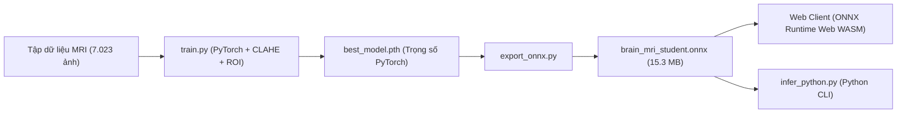

# NeuroScan AI — Module Huấn Luyện & Đóng Gói AI (AI Engine)

Module này cung cấp toàn bộ mã nguồn huấn luyện mô hình học máy (Machine Learning / Deep Learning), quy trình tiền xử lý ảnh y tế và công cụ xuất mô hình từ **PyTorch sang ONNX Runtime Web** để tích hợp trực tiếp lên nền tảng Web.

---

## 1. Cấu Trúc Module

| Tệp tin | Vai trò |
| :--- | :--- |
| `model.py` | Định nghĩa kiến trúc mạng nơ-ron học sinh (Student MobileNetV2 / EfficientNet-B0 với 1280 latent features). |
| `train.py` | Script huấn luyện mô hình trên tập dữ liệu Brain Tumor MRI Dataset (Otsu Contour ROI, CLAHE, Label Smoothing). |
| `export_onnx.py` | Script chuyển đổi checkpoint PyTorch (`.pth`) sang định dạng chuẩn quốc tế `brain_mri_student.onnx`. |
| `infer_python.py` | Script chạy suy luận AI độc lập trên dòng lệnh bằng Python (dành cho kiểm thử hoặc backend Python). |
| `requirements.txt` | Danh sách thư viện Python cần thiết (`torch`, `torchvision`, `onnxruntime`, `opencv-python`, v.v.). |

---

## 2. Quy Trình Từ Huấn Luyện Đến Triển Khai Web (Train-to-Web Pipeline)



---

## 3. Hướng Dẫn Sử Dụng

### Bước 1: Cài đặt môi trường Python
```bash
cd ai_engine
python -m venv .venv
.\.venv\Scripts\activate
pip install -r requirements.txt
```

### Bước 2: Huấn luyện mô hình (Training)
```bash
python train.py --data_dir /path/to/dataset --epochs 25 --batch_size 32 --lr 3e-4 --output best_brain_mri_model.pth
```

### Bước 3: Xuất mô hình sang ONNX Web
```bash
python export_onnx.py --checkpoint best_brain_mri_model.pth --output ../frontend/public/models/brain_mri_student.onnx
```

### Bước 4: Chạy thử suy luận bằng Python độc lập
```bash
python infer_python.py --image ../frontend/public/sample_scans/sample_glioma_axial.jpg --model ../frontend/public/models/brain_mri_student.onnx
```
