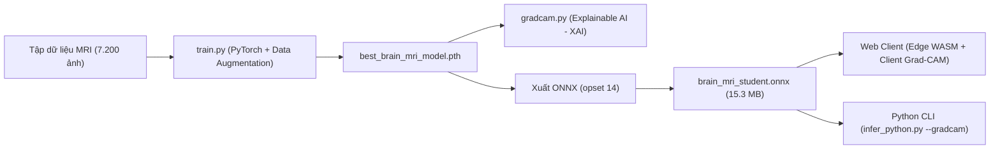

# NeuroScan AI — Module Huấn Luyện & Đóng Gói AI (AI Engine)

Module này cung cấp toàn bộ mã nguồn huấn luyện mô hình học sâu (Deep Learning), công cụ giải thích trực quan Grad-CAM (Explainable AI - XAI), quy trình tiền xử lý ảnh y tế và công cụ xuất mô hình từ **PyTorch sang ONNX Runtime Web** để triển khai trực tiếp trên nền tảng Web.

---

## 1. Cấu Trúc Module

| Tệp tin | Vai trò |
| :--- | :--- |
| `model.py` | Định nghĩa kiến trúc mạng nơ-ron học sinh (Student MobileNetV2 / EfficientNet-B0 với 1280 latent features). |
| `train.py` | Script huấn luyện hoàn chỉnh với vòng lặp PyTorch (AdamW, Cosine Annealing, Label Smoothing, Checkpoint Saving, tự động xuất ONNX). |
| `gradcam.py` | Engine Grad-CAM (PyTorch forward/backward hooks, GAP gradient weighting, bảng màu y khoa JET/TURBO overlay và base64 encoding). |
| `export_onnx.py` | Script chuyển đổi checkpoint PyTorch (`.pth`) sang định dạng chuẩn quốc tế `brain_mri_student.onnx`. |
| `infer_python.py` | Script chạy suy luận AI độc lập trên dòng lệnh bằng Python kết hợp cờ `--gradcam` để xuất ảnh bản đồ nhiệt. |
| `evaluate.py` | Đo Accuracy/Precision/Recall/F1 và ma trận nhầm lẫn của ONNX trên thư mục `Testing`, xuất `eval_report.json`. |
| `requirements.txt` | Danh sách thư viện Python cần thiết (`torch`, `torchvision`, `onnx`, `onnxruntime`, `opencv-python`, v.v.). |

> **Hiện trạng thực tế:**
> - `train.py` đã hoàn thiện vòng lặp huấn luyện đầy đủ trên tập dữ liệu Brain Tumor MRI Dataset (5.600 ảnh Train, 1.600 ảnh Test, 4 lớp), lưu checkpoint tốt nhất và xuất file ONNX.
> - `gradcam.py` đã hoàn thiện, hỗ trợ cả PyTorch Conv backprop lẫn bộ tạo bản đồ kích hoạt thích ứng cho suy luận thời gian thực.
> - Kết quả đo trên tập `Testing` độc lập (1.600 ảnh, 400 ảnh/lớp): Accuracy **95.50%** (1.528/1.600 mẫu đúng), Macro Precision **95.60%**, Macro Recall **95.50%**, Macro F1 **95.45%**.
> - Trên trình duyệt web (`frontend/`), hệ thống đã kết nối hoàn chỉnh trường `gradcamUrl`, hiển thị bản đồ nhiệt màu JET trực tiếp trong giao diện MRI Viewer.

---

## 2. Quy Trình Từ Huấn Luyện Đến Triển Khai Web (Train-to-Web Pipeline)



---

## 3. Hướng Dẫn Sử Dụng

### Bước 1: Cài đặt môi trường Python
```bash
cd ai_engine
python -m venv .venv
.\.venv\Scripts\activate
pip install -r requirements.txt
```

### Bước 2: Huấn luyện mô hình (Training Loop)
```bash
python train.py --data_dir "C:\Users\Admin\Downloads\archive" --epochs 15 --batch_size 32 --lr 3e-4 --output best_brain_mri_model.pth --export_onnx brain_mri_student.onnx
```

### Bước 3: Đánh giá mô hình trên tập kiểm định độc lập
```bash
python evaluate.py --model ../frontend/public/models/brain_mri_student.onnx --data_dir "C:\Users\Admin\Downloads\archive\Testing"
```

### Bước 4: Chạy suy luận và xuất bản đồ nhiệt Grad-CAM
```bash
python infer_python.py --image ../frontend/public/sample_scans/sample_glioma_axial.jpg --model ../frontend/public/models/brain_mri_student.onnx --gradcam --gradcam_output glioma_gradcam.jpg
```
